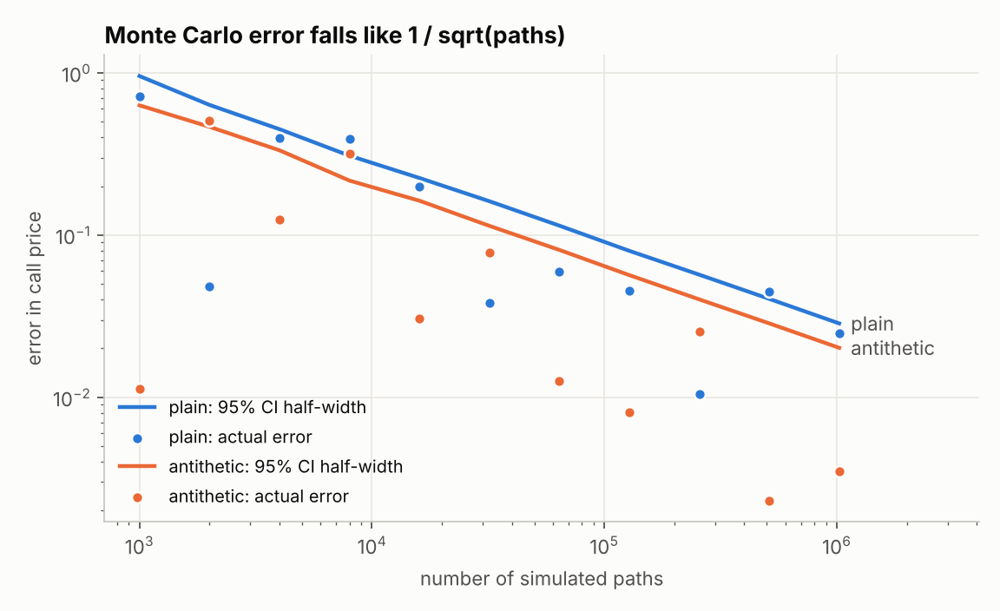
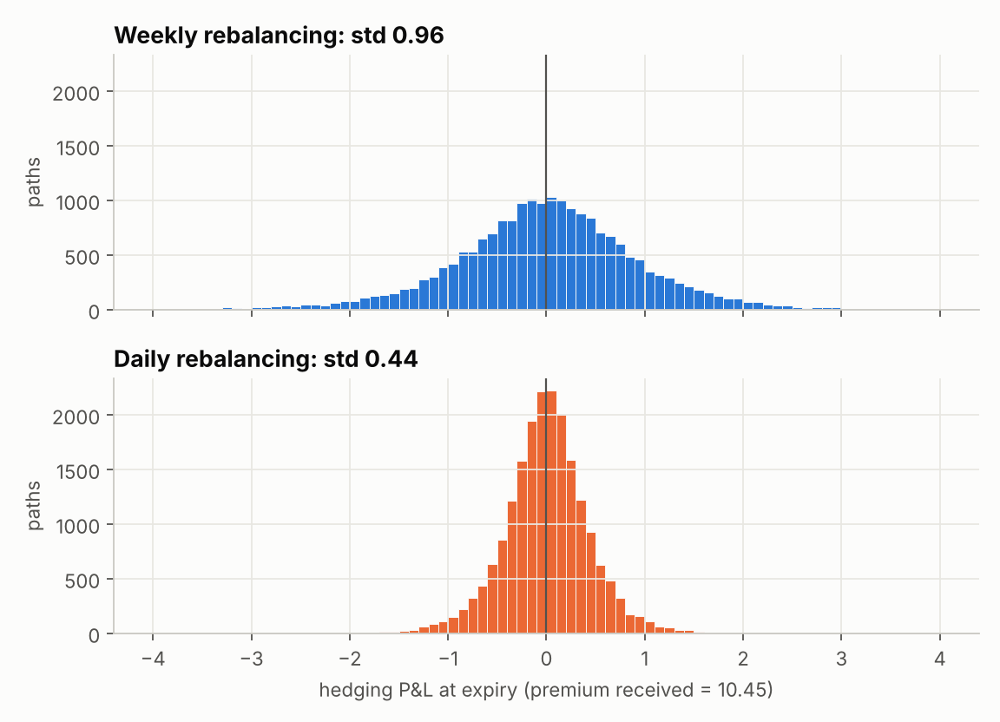
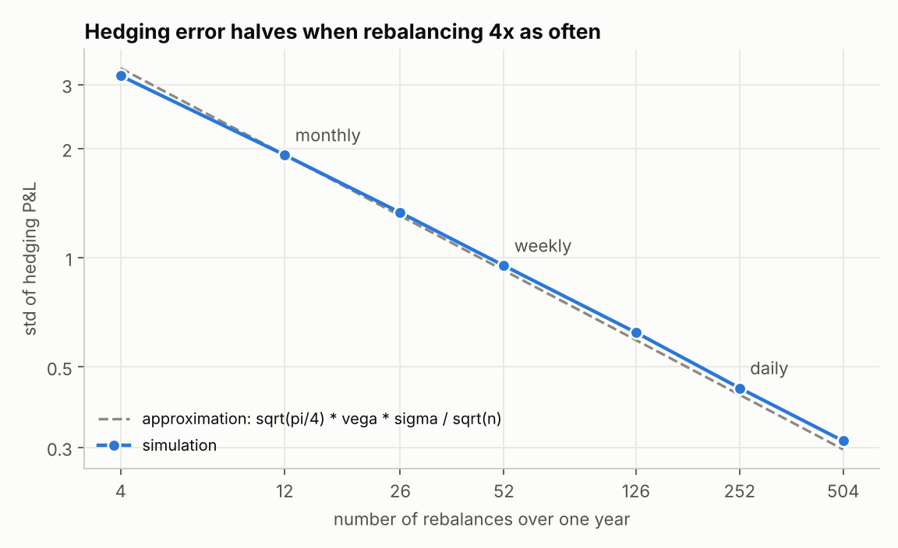
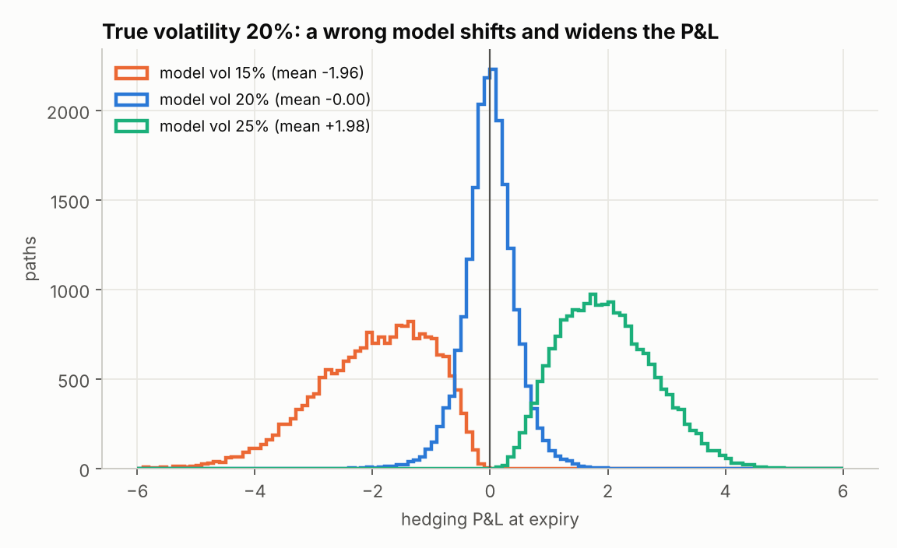
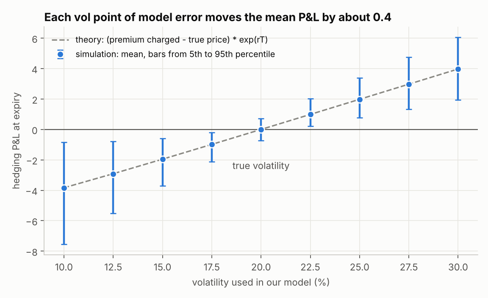

# Option pricing and delta hedging under Black-Scholes

A small Python project that prices European options three ways (closed form, Monte Carlo, and by the cost of a hedging strategy), checks that the three agree, and then measures what happens when the hedger's volatility assumption is wrong.

It is written as a short model-validation report: each section states a claim, how it was tested, and the number that came out.

## Summary of findings

All results are for one option: an at-the-money one-year European call (S = 100, K = 100, T = 1, r = 5%, σ = 20%). Its Black-Scholes price is 10.4506.

| Question | Result |
|---|---|
| Are the closed-form Greeks correct? | All five match finite-difference estimates across three test cases, for calls and puts. |
| Does Monte Carlo agree with the closed form? | Yes. The standard error falls with slope −0.500 against the number of paths on a log-log scale, and the 95% confidence interval contains the Black-Scholes price in 94.8% of 2,000 repeated runs. |
| Do antithetic variates help? | Yes. Standard error falls by a factor of 1.41 for the same number of simulated prices (variance roughly halved). |
| Does delta hedging remove the risk? | Mostly. P&L standard deviation falls from 15.29 unhedged to 0.44 with daily rebalancing, with mean P&L of zero. |
| How does hedging error depend on rebalancing frequency? | It falls roughly like 1/√n. The fitted slope is −0.48, and the level is within 6% of the Derman-Kamal approximation. |
| What does a wrong volatility cost? | About 0.39 of mean P&L per volatility point of model error, and a wider P&L distribution. A model at 15% when the truth is 20% loses money on every simulated path. |

## Repository layout

```
src/optionlab/
    black_scholes.py   closed-form prices and Greeks
    monte_carlo.py     Monte Carlo pricer with confidence interval and antithetic variates
    hedging.py         delta-hedging simulation, with separate true and model volatility
tests/                 69 pytest tests
notebooks/results.ipynb  reproduces every number and plot below
figures/               plots saved by the notebook
```

## How to run

```
python -m venv .venv
source .venv/bin/activate        # Windows: .venv\Scripts\activate
pip install -e ".[dev]"
pytest
jupyter notebook notebooks/results.ipynb
```

Seeds are fixed, so the notebook prints the same numbers on every run.

## 1. Model and assumptions

The stock follows geometric Brownian motion with constant drift μ and constant volatility σ:

```math
dS_t = \mu S_t\,dt + \sigma S_t\,dW_t
```

Further assumptions: a constant risk-free rate r, no dividends, no transaction costs, trading in any fraction of a share, and European exercise only.

## 2. Black-Scholes prices and Greeks

```math
d_1 = \frac{\ln(S/K) + (r + \sigma^2/2)\,T}{\sigma\sqrt{T}}, \qquad d_2 = d_1 - \sigma\sqrt{T}
```

```math
C = S\,N(d_1) - K e^{-rT} N(d_2), \qquad P = K e^{-rT} N(-d_2) - S\,N(-d_1)
```

N is the standard normal distribution function and φ its density.

| Greek | Meaning | Call | Put |
|---|---|---|---|
| Delta | ∂V/∂S | N(d₁) | N(d₁) − 1 |
| Gamma | ∂²V/∂S² | φ(d₁) / (Sσ√T) | same |
| Vega | ∂V/∂σ | S φ(d₁) √T | same |
| Theta | −∂V/∂T | −Sφ(d₁)σ/(2√T) − rKe^(−rT)N(d₂) | −Sφ(d₁)σ/(2√T) + rKe^(−rT)N(−d₂) |
| Rho | ∂V/∂r | KTe^(−rT)N(d₂) | −KTe^(−rT)N(−d₂) |

Units: vega and rho are per 1.00 change in σ and r (divide by 100 for one percentage point), and theta is per year.

Values for the reference option:

| | Price | Delta | Gamma | Vega | Theta | Rho |
|---|---|---|---|---|---|---|
| Call | 10.4506 | 0.6368 | 0.01876 | 37.524 | −6.414 | 53.232 |
| Put | 5.5735 | −0.3632 | 0.01876 | 37.524 | −1.658 | −41.890 |

**Tests**

- Put-call parity, C − P = S − Ke^(−rT), holds to 1e-10 in three cases (at, in and out of the money).
- Each Greek is compared with a central finite difference of the price (gamma with a finite difference of delta), for calls and puts in the same three cases. Tolerances are 1e-6 for delta and gamma, 1e-5 for vega, theta and rho.

## 3. Monte Carlo pricing

Under the risk-neutral measure the price is the discounted expected payoff. The terminal stock price can be sampled exactly, so there is no time-stepping error:

```math
S_T = S_0 \exp\!\big((r - \sigma^2/2)\,T + \sigma\sqrt{T}\,Z\big), \quad Z \sim N(0,1)
```

The estimate is the average of e^(−rT)·payoff over N draws. Its standard error is the sample standard deviation divided by √N, and the 95% confidence interval is the estimate ± 1.96 standard errors.

**Antithetic variates.** Each draw Z is used twice, as +Z and −Z. A call payoff rises with Z, so the two payoffs in a pair are negatively correlated and their average is less noisy than two independent payoffs. The two payoffs in a pair are not independent, so the standard error is computed from the pair averages, not from the individual payoffs.



**Results**

- The standard error falls with slope −0.500 on a log-log scale for both methods, which is the 1/√N rate.
- At 1,024,000 simulated prices the standard error is 0.0145 plain and 0.0103 antithetic. Averaged over all path counts the ratio is 1.41, a variance reduction of about 2. That implies a correlation of about −0.5 between the two payoffs in a pair.
- In the eleven runs plotted, the Black-Scholes price is inside the 95% interval nine times for each method. Eleven runs is too few to judge coverage, so the notebook repeats a 10,000-path run 2,000 times: coverage is 94.8% plain and 94.2% antithetic, against a nominal 95%.

**Tests.** The Black-Scholes price lies inside the 95% interval for calls and puts, plain and antithetic (fixed seed). Across 20 seeds the error never exceeds 4 standard errors. Antithetic standard error is below plain. Four times the paths halves the standard error to within 5%.

## 4. Delta hedging a short call

We sell one call for its Black-Scholes price and hold Δ shares against it, where Δ is the Black-Scholes delta. At each of n equally spaced dates the cash account earns interest, delta is recomputed, and shares are bought or sold to match. At expiry the shares are sold and the payoff is paid. The P&L is what is left, in money at time T.

With continuous rebalancing and a correct model the P&L is exactly zero: that is the argument behind the Black-Scholes price. With rebalancing at discrete dates a random error remains, because between dates delta moves and the hedge does not (gamma risk).



| Strategy (20,000 paths) | Mean P&L | Std | 5th percentile |
|---|---|---|---|
| Unhedged | 0.18 | 15.29 | −31.79 |
| Hedged weekly (52) | 0.00 | 0.96 | −1.57 |
| Hedged daily (252) | 0.00 | 0.44 | −0.72 |

The unhedged mean of 0.18 is simulation noise: its standard error is 15.29/√20,000 ≈ 0.11.

### Hedging error against rebalancing frequency



| Rebalances per year | Std of P&L | As % of premium |
|---|---|---|
| 4 | 3.17 | 30.3% |
| 12 (monthly) | 1.92 | 18.3% |
| 26 | 1.33 | 12.7% |
| 52 (weekly) | 0.95 | 9.1% |
| 126 | 0.62 | 5.9% |
| 252 (daily) | 0.44 | 4.2% |
| 504 | 0.31 | 3.0% |

The fitted log-log slope is −0.48, close to the theoretical −0.5: rebalancing four times as often halves the error. The dashed line is the Derman-Kamal approximation, std ≈ √(π/4) · vega · σ / √n, which is not fitted to the data. The simulation is within 6% of it at every frequency (0.92 predicted against 0.95 simulated for weekly, 0.42 against 0.44 for daily).

**Tests.** Mean P&L is within 4 standard errors of zero for calls and puts. The daily-hedged standard deviation is below 5% of the unhedged one. Four times the rebalances halves the standard deviation to within 10%.

## 5. Model risk: hedging with the wrong volatility

The stock moves with a true volatility of 20%. The hedger's model uses a different volatility σₘ for both the premium charged and every delta. Rebalancing is daily, so the discretisation error from section 4 (std 0.44) is small next to the effect of the wrong model.





| Model vol | Premium charged | Mean P&L | Theory | Std | 5th percentile | Paths with a loss |
|---|---|---|---|---|---|---|
| 10.0% | 6.81 | −3.84 | −3.83 | 2.10 | −7.55 | 100.0% |
| 15.0% | 8.59 | −1.96 | −1.95 | 0.98 | −3.71 | 100.0% |
| 17.5% | 9.52 | −0.98 | −0.98 | 0.60 | −2.11 | 99.2% |
| 20.0% (true) | 10.45 | 0.00 | 0.00 | 0.44 | −0.72 | 49.7% |
| 22.5% | 11.39 | 0.99 | 0.99 | 0.56 | 0.21 | 1.2% |
| 25.0% | 12.34 | 1.98 | 1.98 | 0.80 | 0.79 | 0.0% |
| 30.0% | 14.23 | 3.98 | 3.98 | 1.27 | 1.93 | 0.0% |

**Reading the results**

1. **The mean moves by the mispricing.** The hedging strategy is self-financing, so on average it turns the premium charged into the premium grown at the risk-free rate, while the payoff costs the true price on average. The mean P&L is therefore (C(σₘ) − C(σ_true)) · e^(rT). The "Theory" column is this formula and the simulation matches it to 0.01. For small errors it is about vega × (σₘ − σ_true), which is 0.39 per volatility point here.
2. **The spread widens.** With the wrong delta the hedge no longer cancels the option's moves, so the standard deviation rises from 0.44 to 0.98 at a five-point error. In continuous time the P&L is

   ```math
   \text{P\&L} = \tfrac{1}{2}\int_0^T e^{r(T-t)}\,\Gamma_m(t)\,S_t^2\,\big(\sigma_m^2 - \sigma_{\text{true}}^2\big)\,dt
   ```

   where Γₘ is the gamma in the hedger's model. The sign is fixed by σₘ − σ_true, but the size depends on how much time the path spends where gamma is large (near the strike, close to expiry). That path dependence is what creates the spread.
3. **The two directions are not symmetric for a risk function.** Too low a volatility loses on almost every path, and the loss is locked in at the moment of sale: no later hedging can recover a premium that was too small. Too high a volatility shows a profit in this experiment, but only because the option was sold at the hedger's own price. In a market, an overpriced option would not be sold at all.

The same numbers cover a second case. If the option is sold at the true price and only the deltas use σₘ, the P&L distribution is the one above shifted by the constant mispricing: the mean returns to zero and the standard deviation column is unchanged.

**Tests.** For model volatilities of 15% and 25% the mean P&L is within 4 standard errors of the mispricing formula and has the sign of σₘ − σ_true.

## 6. Limitations

- **The validation is circular on the model itself.** Paths are simulated from the same model that prices and hedges. The tests show the implementation is correct and measure discretisation and parameter error. They do not show that Black-Scholes describes real markets.
- **Volatility is constant.** There is no smile, no stochastic volatility and no jumps. The model-risk experiment changes only the level of a constant volatility. Real model error also includes the wrong dynamics, which this does not capture.
- **No transaction costs.** More rebalancing always looks better here. With costs there is a trade-off and an optimal frequency.
- **One option.** Results are for an at-the-money one-year call. Hedging error depends on gamma, so it differs for other strikes and maturities.
- **Drift equals the risk-free rate** in every experiment. The exact mean-P&L formula in section 5 relies on that.
- **No dividends, constant interest rate, European exercise only.**
- **T = 0 is not handled.** The formulas divide by σ√T. The simulation never evaluates them at expiry.
- **P&L is reported at expiry** and not discounted to today.
- **Simulation noise.** Experiments use 20,000 paths, so a reported standard deviation has a sampling error of roughly 1%.

## References

- Black, F. and Scholes, M. (1973). The Pricing of Options and Corporate Liabilities. *Journal of Political Economy*, 81(3).
- Derman, E. and Kamal, M. (1999). When You Cannot Hedge Continuously: The Corrections of Black-Scholes. Goldman Sachs Quantitative Strategies Research Notes.
- El Karoui, N., Jeanblanc-Picqué, M. and Shreve, S. (1998). Robustness of the Black and Scholes Formula. *Mathematical Finance*, 8(2).
- Glasserman, P. (2003). *Monte Carlo Methods in Financial Engineering*. Springer.
